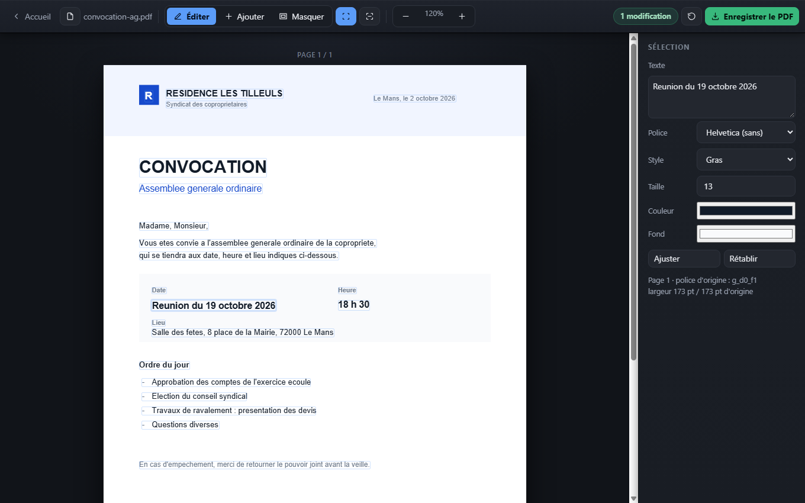

# VoilàPDF

**Corriger le texte déjà écrit dans un PDF — dans le navigateur, sans rien téléverser.**

[voilapdf.com](https://voilapdf.com) · [English version](README.md)

[](LICENSE)
[](#héberger-le-site-soi-même)
[](https://voilapdf.com/confidentialite/)



Tous les services PDF en ligne laissent *ajouter* du texte gratuitement. Corriger
une ligne déjà présente — une date fausse, un nom mal orthographié, une adresse
périmée — est la fonction qu'ils réservent à l'abonnement, parce qu'elle leur
coûte du temps de serveur.

Elle ne coûte rien ici, parce que rien ne tourne sur un serveur. Le fichier est
ouvert, lu et réécrit par l'onglet que vous avez sous les yeux.

```
Votre PDF  →  votre navigateur  →  votre PDF
                     ↑
       rien ne sort, rien n'est conservé
```

---

## Ce qu'il fait

Cliquez sur une ligne, saisissez par-dessus, enregistrez. Sur un document scanné,
la reconnaissance de caractères se lance d'elle-même et rend chaque ligne
reconnue modifiable à sa place.

Vingt-six outils au total :

| | |
|---|---|
| **Éditer** | Modifier le texte · ajouter du texte · masquer une zone · OCR d'un scan |
| **Convertir un PDF** | Word · Excel · PowerPoint · JPG · PNG · PDF scanné en texte |
| **Créer un PDF** | Word · Excel · PowerPoint · JPG · PNG · fusion |
| **Travailler le PDF** | Compresser · diviser · extraire, supprimer ou réorganiser des pages · pivoter · rogner · numéroter · filigrane · signer · déverrouiller · nettoyer les métadonnées |
| **Comprendre un PDF** | Résumer · traduire (français ↔ anglais) |

## Ce qui le rend singulier

Le site **ne contient aucun code serveur**. C'est un ensemble de fichiers
statiques. Il ne pourrait pas recevoir votre document même s'il le voulait — et
la vérification est à votre portée : ouvrez un outil, coupez votre connexion, il
continue de fonctionner.

Aucun compte, aucun cookie, aucune mesure d'audience, aucun `localStorage`,
aucune police distante. La page de confidentialité
[nomme les trois exceptions réelles](https://voilapdf.com/confidentialite/)
plutôt que d'affirmer un absolu qui ne tiendrait pas.

## Comment l'édition fonctionne

C'est la partie intéressante, et la raison pour laquelle la plupart des outils ne
la proposent pas.

`pdf.js` donne la ligne de base, la largeur et le corps exacts de chaque fragment
de texte d'une page. Les fragments partageant une ligne de base sont regroupés en
un bloc modifiable. À l'enregistrement, `pdf-lib` recouvre l'ancienne ligne d'un
rectangle rempli de la **couleur moyenne relevée sur le rendu du fond**, puis
réécrit votre texte sur la même ligne de base.

Deux détails qui ont demandé de mesurer plutôt que de supposer :

- **Le gras se détecte par la largeur, pas par le nom.** Le nom de police inscrit
  dans les métadonnées ment assez souvent pour être inutilisable. Comparer la
  largeur mesurée de la ligne aux métriques des polices standard identifie la
  graisse à 0,2 % près, contre 3,4 % pour la mauvaise graisse.
- **L'italique ne se détecte pas du tout.** Mesurer la pente de l'encre a été
  tenté et marquait trois lignes droites sur quatre. Une heuristique fausse vaut
  moins que pas d'heuristique : elle a été retirée, l'italique se règle à la main.

## Limites, assumées

Elles figurent aussi sur chaque page d'outil. C'est ce qui rend l'outil fiable.

- **Le texte d'origine reste dans le fichier.** La modification le recouvre, elle
  ne le caviarde pas. Un copier-coller ou `pdftotext` le retrouve. Ne pas s'en
  servir pour dissimuler une donnée sensible.
- **Les polices d'origine ne sont pas réemployées.** Le texte est réécrit dans
  l'une des 14 polices standard du PDF (Helvetica, Times, Courier).
- **La compression et le déverrouillage rematricent les pages** : le texte
  devient une image.
- **La conversion vers Office reconstruit le contenu, pas la maquette** : ni
  colonnes, ni encadrés, ni images.
- **La traduction ne conserve pas la mise en page**, et un modèle qui tient dans
  un navigateur ne rivalise pas avec un service hébergé sur cartes graphiques.
- **Caractères** : tout le latin-1 plus la ponctuation typographique
  (œ € – — ' " …). Au-delà, le caractère devient `?` plutôt que de faire échouer
  tout l'enregistrement.

## Héberger le site soi-même

Aucune compilation, aucune dépendance à installer. Servez le dossier :

```bash
git clone https://github.com/dilmseo/editeur-pdf.git
cd editeur-pdf
node serveur.js          # http://127.0.0.1:8080
```

N'importe quel hébergeur statique convient — le site en production est un simple
dépôt de fichiers.

Ouvrir `index.html` directement depuis le disque fonctionne aussi, **sauf
l'OCR** : depuis une origine `file://`, Chrome refuse de construire un Worker et
de lire les données de langue. C'est à cela que sert `serveur.js`.

Pour régénérer les pages d'outil, le sitemap et les résumés destinés aux moteurs
de réponse après avoir modifié le catalogue dans `outils-data.js` :

```bash
node build-pages.js
```

## Construit avec

| Bibliothèque | Rôle | Licence |
|---|---|---|
| [pdf.js](https://github.com/mozilla/pdf.js) 3.11 | lecture, rendu, position du texte | Apache-2.0 |
| [pdf-lib](https://github.com/Hopding/pdf-lib) 1.17 | réécriture du PDF | MIT |
| [tesseract.js](https://github.com/naptha/tesseract.js) 5.1 | reconnaissance de caractères | Apache-2.0 |
| [transformers.js](https://github.com/xenova/transformers.js) 2.17 | résumé, traduction | Apache-2.0 |
| [fflate](https://github.com/101arrowz/fflate) | les fichiers Office sont des ZIP de XML | MIT |

Toutes sont embarquées dans `vendor/`. Les **poids** des modèles de langue, eux,
ne le sont pas : ils sont récupérés chez Hugging Face au premier clic puis gardés
en cache par le navigateur. Le modèle descend ; votre document ne monte jamais.

## Licence

[GNU AGPL v3](LICENSE).

Utilisez-le, modifiez-le, redistribuez-le, y compris commercialement. La seule
contrepartie est l'article 13 : **si vous exploitez une version modifiée sur un
réseau, vous devez en proposer le code source à ses utilisateurs.** C'est
délibéré. Tout l'intérêt de cet outil tient à ce que n'importe qui puisse
vérifier que le document ne part nulle part — et cette vérification doit rester
possible sur les versions dérivées.

Édité par [Fix72](https://voilapdf.com/mentions-legales/), Le Mans, France.
